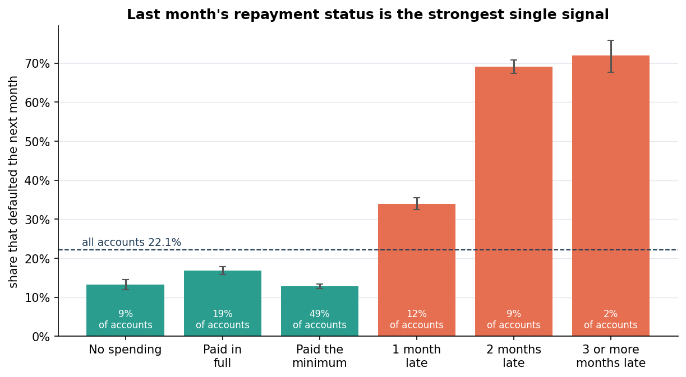
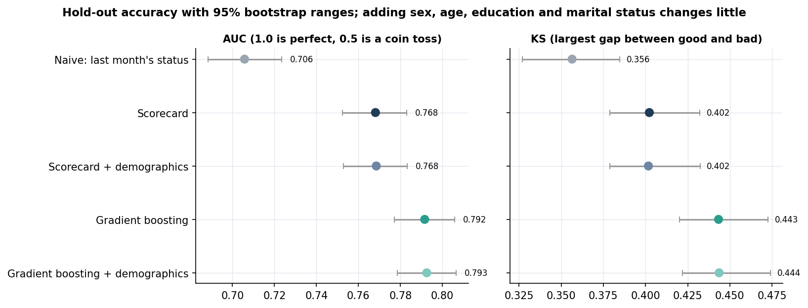
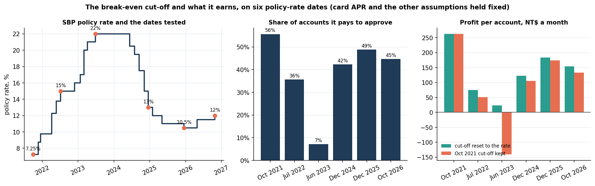
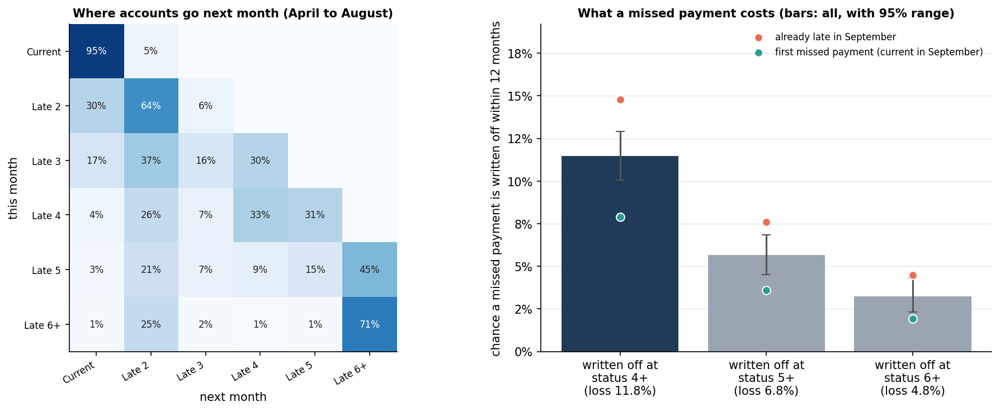
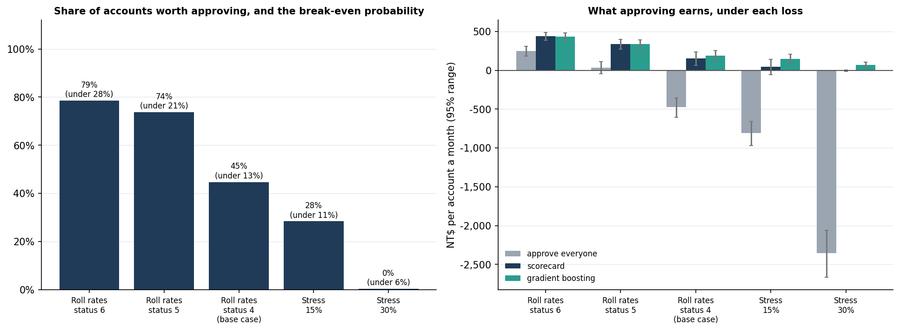
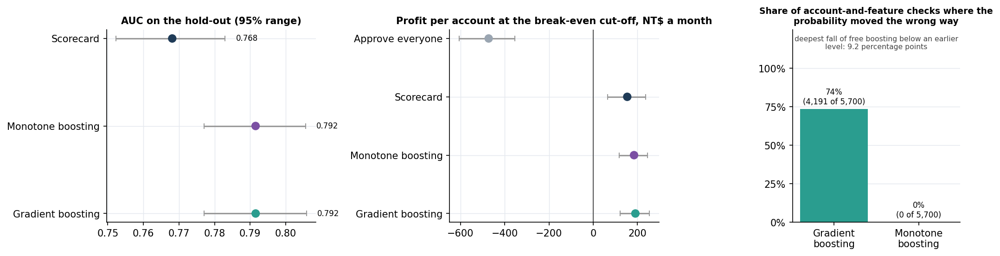
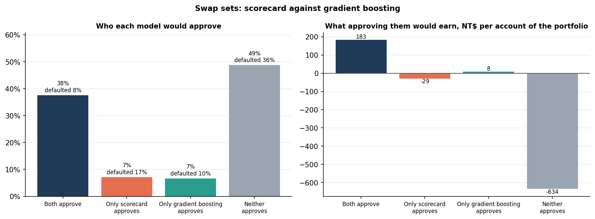
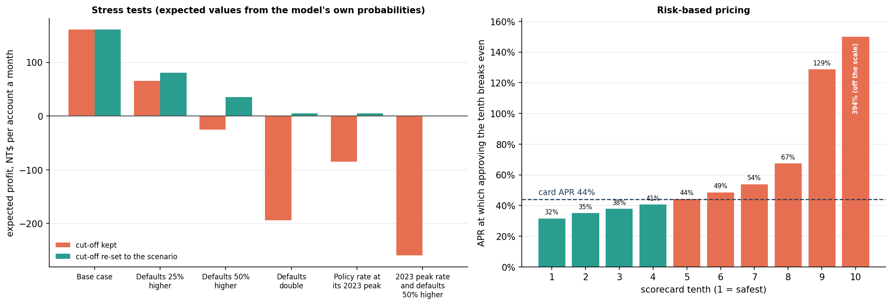
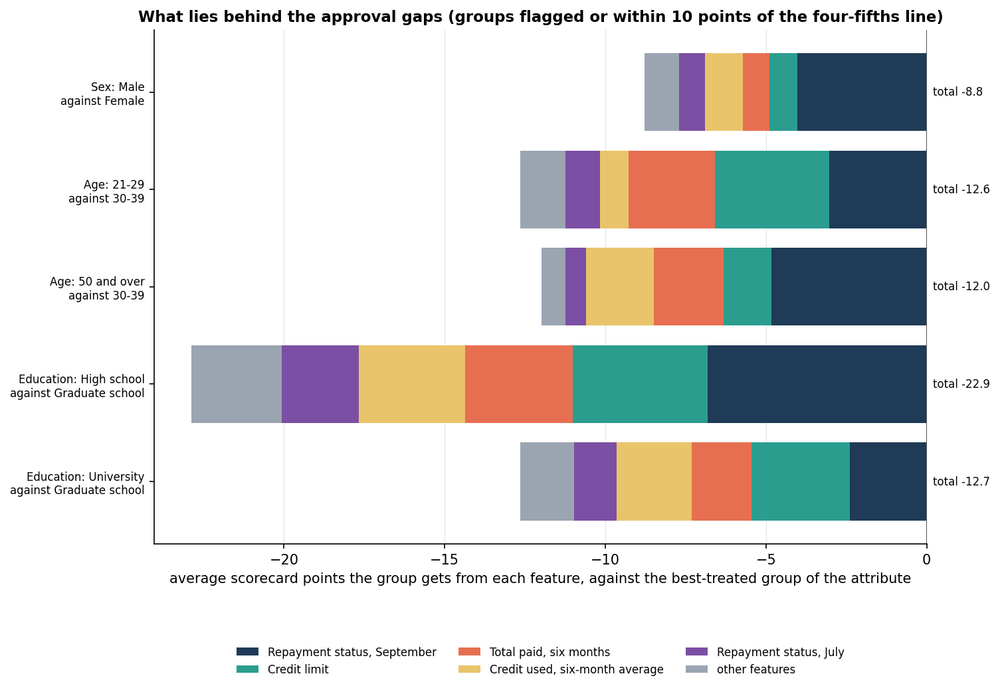

# Credit card default scorecard

**Who will miss next month's card payment, and where should a lender draw the line?**

A points scorecard of the kind banks use, built on 30,000 credit card accounts, tested against a gradient-boosting model, checked for calibration and fairness, and priced with Pakistan's policy rate: the dearer money gets, the safer an account has to be to be worth approving.

[**Interactive dashboard**](dashboard/dashboard.html) (open it in a browser; no server needed) · [Recommendation memo](docs/recommendation_memo.md) · [Method](docs/methodology.md) · [Model card](docs/model_card.md) · [Data sources](docs/data_sources.md) · [Walkthrough notebook](notebooks/credit_risk_walkthrough.ipynb)

> **Read this first.** The cardholders are 30,000 accounts of one bank in Taiwan in 2005, not Pakistani borrowers (I found no public borrower-level credit data for Pakistan). "Default" means *missing next month's payment*, not a loan written off. What is Pakistani is the cost of money (the State Bank of Pakistan's policy rate, 12% on 27 October 2026) and the card pricing (MCB's published markup). The running cost is an assumption and the loss on a missed payment is estimated from this file's own roll rates, with two assumptions of its own; the answer moves a lot with them. This is a method demonstration, not lending advice.

## The answer

- **The risk is in recent behaviour.** 22.1% of the accounts missed the next payment. Accounts that paid the minimum last month defaulted 12.8% of the time, accounts one month late 34%, two months late 69%. The 23% of accounts that were late last month produced 52% of the defaults, so 48% of the defaults came from accounts that looked fine on that measure.
- **A transparent scorecard gets most of the way to a machine-learning model.** On 6,000 hold-out accounts the scorecard has an AUC of **0.768** (95% range 0.752 to 0.783): a random defaulter scores riskier than a random payer 76.8% of the time. A rule that only reads last month's status gets 0.706; gradient boosting gets 0.792. Gradient boosting ranks better by 0.023 AUC (95% range 0.017 to 0.031), a difference that is larger than the noise of a 6,000-account test. The scorecard keeps 92% of the gradient-boosting model's lead over a coin toss, and unlike it can be read line by line.
- **It finds defaults the naive rule cannot.** Among the 4,650 hold-out accounts that were *not* late last month (660 of them defaulted), the AUC is 0.53 for the naive rule, 0.66 for the scorecard and 0.71 for gradient boosting (0.5 is a coin toss).
- **Its probabilities are honest.** Calibration slope 1.00 on the hold-out (1.00 is perfect). The riskiest three tenths of accounts hold 61% of all defaults, against 57% for the naive rule and 64% for gradient boosting; in the riskiest tenth alone all three find about a third (31%, 32%, 32%): the obvious cases.
- **Fairness.** Sex, age, education and marital status are not inputs. At the break-even cut-off, 3 of 11 groups are approved at under four-fifths of the best-treated group's rate: age: 21-29, age: 50 and over and education: High school; for education: High school the whole 95% bootstrap range of the ratio is under 0.80, for the rest it reaches above it. Adding sex, age, education and marital status changes the scorecard's hold-out AUC by +0.0004 (95% range -0.0012 to +0.0020) and the gradient-boosting model's by +0.0010 (-0.0009 to +0.0028), so leaving them out costs almost nothing.
- **The cut-off depends on the cost of money.** Under the stated assumptions (card APR 44%, money at the policy rate of 12%, loss 11.8% of the balance on a missed payment, estimated from the roll rates) an account is worth approving only while its probability of default is under **13.4%**, which is a score of **535** or more. On the hold-out accounts that approves 45% of them, 9.2% of whom default, and earns NT$154 per account a month (95% range NT$65 to NT$236) against -NT$473 if everyone were approved. The scorecard's profit is clearly above zero on this test, and the gain over approving everyone is larger than the noise. At the same cut-off gradient boosting earns NT$191 (NT$37 more per account a month than the scorecard; 95% range -NT$25 to NT$96: a difference that could be chance on a test this size).
- **When the policy rate moves, so should the cut-off.** At the 7.25% low of 1 October 2021 the break-even probability is 15.9% and 56% of accounts are worth approving; at the 22% peak of 27 June 2023 it is 7.7% and 7%. At the peak, keeping the earlier cut-off would have lost money on the accounts it approved (-NT$141 per account a month, against NT$23 with the cut-off reset). The reset cut-off earned more than the Oct 2021 one on 5 of the 5 later dates.
- **The loss on a missed payment is estimated from the data, not guessed.** In the file's own repayment history an account that is late recovers by the next month 30% of the time, stays at the same level 64% and gets worse 6%. The chance that an account that misses a payment is written off within 12 months is 11.5% (95% range 10.1% to 12.9%) at the conservative status-4 line, which with 85% of the balance never recovered and 2% for collection is a loss of 11.8%. At the lowest loss the roll rates support (4.8%), approving everyone earns NT$248 per account a month and the break-even probability is 27.6%, so 79% of accounts are worth approving; at the base case (11.8%) approving everyone loses NT$473 and 45% are worth approving; at the 15% stress loss only 28% are.
- **An explainable boosting model.** A boosting model told which way 19 features must push the probability reaches an AUC of 0.792: level with free boosting's (95% range of the gap -0.0015 to +0.0016; within the noise) and 0.023 above the scorecard's (+0.0173 to +0.0304; a real gap). At the break-even cut-off it earns NT$185 per account a month: NT$31 more than the scorecard's NT$154 (95% range of the gap -NT$27 to NT$93; a difference that could be chance on a test this size), against NT$191 for free boosting. Moving each constrained feature across its range for 300 sampled accounts (5,700 account-and-feature checks), free boosting moved the wrong way somewhere along the range in 4,191 of them (74%) and the monotone model in none; where free boosting did, the probability fell below an earlier level by 0.6 percentage points on average and by as much as 9.2 percentage points.
- **Stress tests and pricing.** With defaults 50% higher and the cut-off kept, expected profit goes from NT$161 to -NT$25 a month; re-setting the cut-off gives NT$35 on 17% of accounts. At the 2023 peak policy rate the kept cut-off gives -NT$85 and a re-set one NT$5; with defaults 50% higher as well, -NT$260 against NT$0. At the current card APR of 44%, approving pays for the safest 4 of 10 tenths of accounts. The other 6 would need APRs from 44% to 394% to break even. The riskiest need prices far above the one card rate checked here (MCB's published 44%), so for them the choice is to decline or to limit the exposure, not to price for risk.

## Figures

| | |
|---|---|
|  |  |
|  |  |
|  |  |

The second layer (roll rates and the loss, explainable boosting, swap sets, stress tests and pricing, what drives the fairness gaps):

| | |
|---|---|
|  |  |
|  |  |
|  |  |

More in [`docs/figures`](docs/figures): risk drivers, ROC and lift curves, score distribution, what the gradient-boosting model relies on, the sensitivity grid, the fairness audit and the Pakistan context.

## What was done

1. **Data.** The UCI "Default of Credit Card Clients" file (30,000 accounts, six months of status, bills and payments, and whether the account missed its payment in October 2005), cleaned without dropping any account ([details](docs/data_sources.md)).
2. **Split.** 24,000 accounts for building everything, 6,000 kept aside and used once. Identical accounts never straddle the split.
3. **Features.** 20 measures built from each account's own history (months late, share of the last bill paid, credit used, and so on).
4. **Scorecard.** Each candidate feature is binned by merging neighbours that lose least information, weights of evidence are fed to a logistic regression with positive, significant coefficients, and the result becomes whole points: 600 points at 20:1 odds of a good account, 40 points to double the odds. 8 of 21 candidates ended up in the card, in 37 bins.
5. **Challenger.** LightGBM, 14 settings tried by cross-validation, recalibrated; plus a naive rule for scale.
6. **Validation.** AUC, KS, Brier score, calibration, lift and population stability, with bootstrap ranges; cross-validation with every step refitted.
7. **Fairness audit.** Approval, error rates and calibration by sex, age, education and marital status, and whether the inputs act as a stand-in for them.
8. **Cut-off.** Profit per unit of balance, month by month, under stated assumptions, then repeated for the policy rate on six dates and for a grid of assumptions.
9. **Going further.** The loss on a missed payment measured from roll rates instead of guessed, an explainable boosting model whose directions are checked, swap sets between models, stress tests, risk-based pricing, re-anchoring the scorecard to another lender, and what drives the approval gaps (the section below).

## Results

| Model | AUC, cross-validated | AUC, hold-out (95% range) | KS, hold-out (95% range) | Brier | Calibration slope | Defaults in riskiest tenth |
| --- | ---: | ---: | ---: | ---: | ---: | ---: |
| Naive: last month's status only | 0.713 | **0.706** (0.688 to 0.723) | 0.356 (0.327 to 0.385) | 0.1427 | 0.98 | 32% |
| Scorecard | 0.769 | **0.768** (0.752 to 0.783) | 0.402 (0.379 to 0.432) | 0.1373 | 1.00 | 31% |
| Scorecard + sex, age, education, marriage | 0.769 | **0.768** (0.753 to 0.783) | 0.402 (0.379 to 0.432) | 0.1373 | 1.00 | 31% |
| Gradient boosting | 0.786 | **0.792** (0.777 to 0.806) | 0.443 (0.420 to 0.473) | 0.1332 | 1.01 | 32% |
| Gradient boosting + sex, age, education, marriage | 0.787 | **0.793** (0.778 to 0.807) | 0.444 (0.422 to 0.474) | 0.1328 | 1.02 | 32% |

AUC is the chance that a random defaulter scores riskier than a random payer (0.5 is a coin toss, 1 is perfect); KS is the largest gap between the two groups' cumulative score distributions. Cross-validated AUC is the average of 3 × 5 refits on the development accounts; the hold-out columns are the single final test. Which differences are bigger than chance:

| Comparison | AUC difference | 95% range | Verdict |
| --- | ---: | ---: | --- |
| Scorecard against naive: last month's status only | +0.0624 | +0.0490 to +0.0758 | a real difference |
| Gradient boosting against Scorecard | +0.0234 | +0.0170 to +0.0306 | a real difference |
| Scorecard + sex, age, education, marriage against Scorecard | +0.0004 | -0.0012 to +0.0020 | within the noise |
| Gradient boosting + sex, age, education, marriage against Gradient boosting | +0.0010 | -0.0009 to +0.0028 | within the noise |

### The scorecard

The card's three heaviest features are Repayment status, September (121 points between its best and worst bin), Total paid, six months (37) and Repayment status, May (31). The score is the sum of the points; more points is safer. The full card is in the [method](docs/methodology.md); the first three features:

| Feature | Bin | Accounts | Default rate | Points |
| --- | --- | ---: | ---: | ---: |
| **Repayment status, September** | -2 | 2,205 | 13.3% | 89 |
|  | -1 | 4,539 | 16.6% | 78 |
|  | 0 | 11,788 | 12.7% | 92 |
|  | 1 | 2,946 | 34.3% | 36 |
|  | 2 or more | 2,522 | 69.5% | -29 |
| **Total paid, six months** | 7,100 or less | 6,426 | 30.8% | 51 |
|  | 7,101 to 14,300 | 5,578 | 26.1% | 57 |
|  | 14,301 to 22,400 | 3,209 | 19.1% | 67 |
|  | 22,401 to 57,300 | 5,588 | 16.5% | 72 |
|  | 57,301 to 99,000 | 1,597 | 12.0% | 81 |
|  | 99,001 or more | 1,602 | 9.2% | 88 |
| **Repayment status, May** | -2 | 3,641 | 19.8% | 65 |
|  | -1 | 4,418 | 15.8% | 69 |
|  | 0 to 1 | 13,561 | 19.0% | 66 |
|  | 2 or more | 2,380 | 55.0% | 38 |

The gradient-boosting model leans on Repayment status, September, Months since the last late payment and Worst repayment status in six months.

### What approving is worth

Profit per account in the whole portfolio, per month, on the hold-out accounts and the base-case assumptions (declined accounts earn nothing):

| Rule | Approved | Default rate of approved | Profit per account a month | 95% range | Better than approving everyone by |
| --- | ---: | ---: | ---: | ---: | ---: |
| Approve everyone | 100% | 22.1% | -NT$473 | -NT$607 to -NT$354 |  |
| Approve if not late last month (status 0 or better) | 78% | 14.2% | NT$89 | -NT$9 to NT$179 | NT$562 (NT$488 to NT$645) |
| Scorecard, at the break-even probability | 45% | 9.2% | NT$154 | NT$65 to NT$236 | NT$627 (NT$539 to NT$722) |
| Gradient boosting, at the break-even probability | 44% | 7.9% | NT$191 | NT$121 to NT$254 | NT$663 (NT$559 to NT$769) |

### The policy rate and the cut-off

| Policy rate on | Rate | Margin a month | Break-even probability | Approved | Default rate of approved | Profit per account a month | If the Oct 2021 cut-off were kept |
| --- | ---: | ---: | ---: | ---: | ---: | ---: | ---: |
| 1 October 2021 | 7.25% | 2.21% | 15.9% | 56% | 10.2% | NT$263 | NT$263 |
| 8 July 2022 | 15% | 1.57% | 11.8% | 36% | 8.3% | NT$74 | NT$51 |
| 27 June 2023 | 22% | 0.99% | 7.7% | 7% | 4.0% | NT$23 | -NT$141 |
| 17 December 2024 | 13% | 1.74% | 12.9% | 42% | 9.1% | NT$122 | NT$106 |
| 16 December 2025 | 10.5% | 1.94% | 14.2% | 49% | 9.5% | NT$183 | NT$174 |
| 27 October 2026 | 12% | 1.82% | 13.4% | 45% | 9.2% | NT$154 | NT$133 |

### How much the assumptions matter

Share of accounts worth approving (and the break-even probability) for combinations of card APR and loss on a missed payment (the three roll-rate values, then 15% and 30% as stresses), at the current policy rate; across this grid the break-even probability runs from 2.6% to 27.6% and the share approved from 0% to 79%:

| Card APR, loss on a missed payment: | 4.8% | 6.8% | 11.8% | 15.0% | 30.0% |
| --- | ---: | ---: | ---: | ---: | ---: |
| 44% | 79% (under 27.6%) | 74% (under 21.0%) | 45% (under 13.4%) | 28% (under 10.8%) | 0% (under 5.7%) |
| 36% | 72% (under 20.5%) | 55% (under 15.3%) | 18% (under 9.5%) | 6% (under 7.6%) | 0% (under 3.9%) |
| 30% | 49% (under 14.2%) | 25% (under 10.4%) | 2% (under 6.3%) | 0% (under 5.0%) | 0% (under 2.6%) |

### Fairness at the cut-off

| Group (hold-out) | Accounts | Default rate | Predicted | Predicted ÷ observed | Approved | Default rate of approved | Disparate impact | 95% range of the ratio |
| --- | ---: | ---: | ---: | ---: | ---: | ---: | ---: | ---: |
| Sex: Female | 3,645 | 20.9% | 20.8% | 1.00 | 47% | 9.4% | 1.00 | 1.00 to 1.00 |
| Sex: Male | 2,355 | 24.1% | 23.6% | 0.98 | 41% | 8.8% | 0.86 | 0.82 to 0.92 |
| Age: 21-29 | 1,936 | 23.1% | 23.6% | 1.02 | 39% | 9.3% | 0.77 **flag** | 0.71 to 0.82 |
| Age: 30-39 | 2,222 | 20.1% | 20.2% | 1.01 | 51% | 8.3% | 1.00 | 1.00 to 1.00 |
| Age: 40-49 | 1,283 | 22.7% | 21.5% | 0.95 | 46% | 10.0% | 0.90 | 0.84 to 0.97 |
| Age: 50 and over | 559 | 25.4% | 23.5% | 0.93 | 38% | 10.7% | 0.76 **flag** | 0.67 to 0.84 |
| Education: Graduate school | 2,082 | 18.9% | 19.1% | 1.01 | 52% | 8.3% | 1.00 | 1.00 to 1.00 |
| Education: High school | 991 | 25.6% | 25.9% | 1.01 | 34% | 9.8% | 0.65 **flag** | 0.59 to 0.72 |
| Education: Other or unknown | 93 | 5.4% | 16.4% | 3.05 | 62% | 6.9% |  |  |
| Education: University | 2,834 | 23.8% | 22.7% | 0.96 | 42% | 9.9% | 0.81 | 0.76 to 0.85 |
| Marital status: Married | 2,718 | 23.4% | 21.9% | 0.93 | 45% | 10.2% | 1.00 | 0.95 to 1.00 |
| Marital status: Other or unknown | 69 | 23.2% | 24.4% | 1.05 | 33% | 13.0% |  |  |
| Marital status: Single | 3,213 | 21.0% | 21.9% | 1.04 | 45% | 8.2% | 1.00 | 0.94 to 1.00 |

"Disparate impact" is a group's approval rate over that of the best-treated group; under 0.80 is flagged (the "four-fifths" screening rule used in US lending and employment practice, not a Pakistani legal test). "Predicted ÷ observed" near 1.00 means the model is neither too harsh nor too lenient on that group on average. Details and the proxy test are in the [model card](docs/model_card.md).

## Going further

### What a missed payment costs: roll rates

The label is a missed payment, not a write-off, so the loss on it is not in the data. It is estimated from how accounts move between repayment statuses from one month to the next: 96,000 month-to-month moves in April to August, the months coded on one basis. A late account recovers by the next month 30% of the time, stays at the same level 64% and gets worse 6%; 5.0% of current accounts become late in a month.

| This month, next month: | Current | Late 2 | Late 3 | Late 4 | Late 5 | Late 6+ | Moves |
| --- | ---: | ---: | ---: | ---: | ---: | ---: | ---: |
| Current | 95% | 5% |  |  |  |  | 84,974 |
| Late 2 | 30% | 64% | 6% |  |  |  | 9,901 |
| Late 3 | 17% | 37% | 16% | 30% |  |  | 614 |
| Late 4 | 4% | 26% | 7% | 33% | 31% |  | 239 |
| Late 5 | 3% | 21% | 7% | 9% | 15% | 45% | 75 |
| Late 6+ | 1% | 25% | 2% | 1% | 1% | 71% | 197 |

The accounts that really missed their payment stood in different places in September (48% were current, 47% at the first late level, 5% deeper). Having missed a payment, each is late in October: a current account has just slipped to the first late level, a late one stayed or got worse. So each is moved one month on using the matrix's own odds of the late states (93% land on the first late level, 5% one level deeper, 2% at or beyond the write-off line), and the ladder is followed from there for 12 months. That gives the chance of a write-off, and so the loss:

| Written off at | Chance within 12 months | 95% range | Loss | 95% range |
| --- | ---: | ---: | ---: | ---: |
| Status 4 or worse (base case) | 11.5% | 10.1% to 12.9% | 11.8% | 10.6% to 13.0% |
| Status 5 or worse | 5.7% | 4.5% to 6.8% | 6.8% | 5.8% to 7.8% |
| Status 6 or worse | 3.3% | 2.3% to 4.3% | 4.8% | 4.0% to 5.7% |

Loss = 85% of the balance never recovered x the chance + 2% for collection and the income lost while the account is late. The loss depends on where the account stood. A first missed payment (an account that was current in September, 48% of the missed payments) is written off within 12 months 7.9% of the time, a loss of 8.7%; an account that was already late (52%), 14.8% of the time, a loss of 14.6%. The base case is the mix of the two, so a book of mostly current accounts would sit nearer the first figure.

| Where the account stood in September | Share of missed payments | Written off at status 4+ (loss) | Written off at status 5+ (loss) | Written off at status 6+ (loss) | 95% range, status 4+ |
| --- | ---: | ---: | ---: | ---: | ---: |
| Current in September | 48% | 7.9% (8.7%) | 3.6% (5.1%) | 1.9% (3.6%) | 6.9% to 9.0% |
| Late in September | 52% | 14.8% (14.6%) | 7.6% (8.5%) | 4.5% (5.8%) | 13.1% to 16.6% |

The base case uses the conservative line, status 4; 15% (the placeholder used before the roll rates were estimated) is kept as a stress case. The ladder assumes the roll rates of April to August hold for a year, in a file that is the start of a card-debt crisis, so later roll rates were probably worse: read the loss as a floor, not a forecast. How the status codes map to months is not documented.

What each loss does to the cut-off (hold-out accounts, base-case yield and funding cost):

| Loss case | Loss | Break-even probability | Scorecard approves | Scorecard profit per account a month (95% range) | Approving everyone | Gradient boosting |
| --- | ---: | ---: | ---: | ---: | ---: | ---: |
| Roll rates, written off at status 6 | 4.8% | 27.6% | 79% | NT$441 (NT$388 to NT$489) | NT$248 | NT$434 |
| Roll rates, written off at status 5 | 6.8% | 21.0% | 74% | NT$337 (NT$273 to NT$398) | NT$36 | NT$338 |
| Roll rates, written off at status 4 (base case) | 11.8% | 13.4% | 45% | NT$154 (NT$65 to NT$236) | -NT$473 | NT$191 |
| Stress: 15% of the balance | 15.0% | 10.8% | 28% | NT$42 (-NT$57 to NT$138) | -NT$807 | NT$146 |
| Stress: 30% of the balance | 30.0% | 5.7% | 0% | -NT$2 (-NT$13 to NT$5) | -NT$2,354 | NT$71 |

### An explainable boosting model

The gradient-boosting model is told, for 19 features where the direction is obvious (credit limit, payments, months late, the share of the bill paid), that more of the feature can never mean less risk. Repayment statuses and credit used are left free, because the first are codes and the second is U-shaped at the low end.

| Model | AUC (95% range) | KS | Brier | Calibration slope | Profit per account at the break-even cut-off (95% range) |
| --- | ---: | ---: | ---: | ---: | ---: |
| Scorecard | 0.768 (0.752 to 0.783) | 0.402 | 0.1373 | 1.00 | NT$154 (NT$65 to NT$236) |
| Monotone boosting | 0.792 (0.777 to 0.806) | 0.455 | 0.1331 | 1.02 | NT$185 (NT$118 to NT$246) |
| Gradient boosting | 0.792 (0.777 to 0.806) | 0.443 | 0.1332 | 1.01 | NT$191 (NT$121 to NT$254) |

A boosting model told which way 19 features must push the probability reaches an AUC of 0.792: level with free boosting's (95% range of the gap -0.0015 to +0.0016; within the noise) and 0.023 above the scorecard's (+0.0173 to +0.0304; a real gap). At the break-even cut-off it earns NT$185 per account a month: NT$31 more than the scorecard's NT$154 (95% range of the gap -NT$27 to NT$93; a difference that could be chance on a test this size), against NT$191 for free boosting. Moving each constrained feature across its range for 300 sampled accounts (5,700 account-and-feature checks), free boosting moved the wrong way somewhere along the range in 4,191 of them (74%) and the monotone model in none; where free boosting did, the probability fell below an earlier level by 0.6 percentage points on average and by as much as 9.2 percentage points.

### Swap sets

A swap set shows where two models disagree and who was right. At the break-even cut-off:

**Scorecard against gradient boosting**

| Who approves | Accounts | Defaulted | Average balance | Profit if approved |
| --- | ---: | ---: | ---: | ---: |
| Both approve | 37.6% | 7.6% | NT$65,534 | NT$183 |
| Only scorecard approves | 7.1% | 17.3% | NT$113,995 | -NT$29 |
| Only gradient boosting approves | 6.6% | 9.6% | NT$34,703 | NT$8 |
| Neither approves | 48.7% | 35.7% | NT$32,639 | -NT$634 |

**Scorecard against monotone boosting**

| Who approves | Accounts | Defaulted | Average balance | Profit if approved |
| --- | ---: | ---: | ---: | ---: |
| Both approve | 37.0% | 7.6% | NT$64,404 | NT$177 |
| Only scorecard approves | 7.6% | 16.8% | NT$116,198 | -NT$23 |
| Only monotone boosting approves | 5.3% | 9.8% | NT$36,334 | NT$8 |
| Neither approves | 50.0% | 35.0% | NT$32,522 | -NT$634 |

**Monotone boosting against gradient boosting**

| Who approves | Accounts | Defaulted | Average balance | Profit if approved |
| --- | ---: | ---: | ---: | ---: |
| Both approve | 41.4% | 7.8% | NT$60,947 | NT$195 |
| Only monotone boosting approves | 0.9% | 11.1% | NT$59,225 | -NT$10 |
| Only gradient boosting approves | 2.8% | 9.7% | NT$60,628 | -NT$4 |
| Neither approves | 54.9% | 33.7% | NT$42,768 | -NT$653 |

The scorecard and gradient boosting decide alike on 86% of accounts. Of the 13.7% they split on, those only gradient boosting approves defaulted at 9.6% and carry an average balance of NT$34,703, against 17.3% and NT$113,995 for those only the scorecard approves; approving the first group would have earned NT$8 per account of the portfolio, the second -NT$29.

### Stress tests and pricing

Expected profit per account a month from the scorecard's own probabilities, when defaults rise (the odds are multiplied by the factor in the name) or money gets dearer, with the cut-off kept and with it re-set. These are expected values, not outcomes: the file has no accounts that lived through a different year.

| Scenario | Policy rate | Average default probability | Cut-off kept: approved | Kept: expected profit | Re-set: approved | Re-set: expected profit |
| --- | ---: | ---: | ---: | ---: | ---: | ---: |
| Base case | 12% | 21.9% | 45% | NT$161 | 45% | NT$161 |
| Defaults 25% higher | 12% | 25.1% | 45% | NT$66 | 30% | NT$81 |
| Defaults 50% higher | 12% | 27.9% | 45% | -NT$25 | 17% | NT$35 |
| Defaults double | 12% | 32.7% | 45% | -NT$194 | 5% | NT$5 |
| Policy rate at its 2023 peak | 22% | 21.9% | 45% | -NT$85 | 7% | NT$5 |
| 2023 peak rate and defaults 50% higher | 22% | 27.9% | 45% | -NT$260 | 0% | NT$0 |

With defaults 50% higher and the cut-off kept, expected profit goes from NT$161 to -NT$25 a month; re-setting the cut-off gives NT$35 on 17% of accounts. At the 2023 peak policy rate the kept cut-off gives -NT$85 and a re-set one NT$5; with defaults 50% higher as well, -NT$260 against NT$0.

Risk-based pricing asks the reverse question: what APR would make approving each tenth of accounts break even?

| Tenth (1 = safest) | Average default probability | Average balance | Break-even APR | Pays at the current APR | Expected profit per account a month |
| ---: | ---: | ---: | ---: | --- | ---: |
| 1 | 7.1% | NT$75,014 | 32% | yes | NT$624 |
| 2 | 9.0% | NT$80,734 | 35% | yes | NT$482 |
| 3 | 10.4% | NT$78,836 | 38% | yes | NT$329 |
| 4 | 11.7% | NT$67,675 | 41% | yes | NT$159 |
| 5 | 13.5% | NT$43,356 | 44% | no | NT$1 |
| 6 | 15.5% | NT$35,856 | 49% | no | -NT$97 |
| 7 | 17.8% | NT$18,423 | 54% | no | -NT$109 |
| 8 | 23.1% | NT$20,864 | 67% | no | -NT$265 |
| 9 | 40.6% | NT$36,734 | 129% | no | -NT$1,537 |
| 10 | 70.1% | NT$51,873 | 394% | no | -NT$3,873 |

At the current card APR of 44%, approving pays for the safest 4 of 10 tenths of accounts. The other 6 would need APRs from 44% to 394% to break even. The riskiest need prices far above the one card rate checked here (MCB's published 44%), so for them the choice is to decline or to limit the exposure, not to price for risk.

### Moving the scorecard to another lender

The ranking carries over to another lender's accounts; the probabilities do not. A lender whose accounts miss a payment at a different rate moves every log-odds by the difference between the two base log-odds (the usual correction for a change in the base rate) and gets a different cut-off:

| Monthly missed-payment rate of the lender's accounts | Cut-off score | Share approved | Expected default rate of approved | Expected profit per account a month |
| ---: | ---: | ---: | ---: | ---: |
| 5.0% | 438 | 87% | 3.4% | NT$638 |
| 8.0% | 467 | 82% | 4.8% | NT$546 |
| 12.0% | 493 | 77% | 6.7% | NT$431 |
| 22.1% (this file) | 535 | 45% | 9.9% | NT$161 |

A lender whose accounts miss a payment 8.0% of the time, instead of 22.1%, would put the cut-off at 467 points instead of 535 and approve 82% of accounts instead of 45%, with the same economics and the same ranking.

### What drives the approval gaps

The scorecard adds up points, so a group's gap to the best-treated group of its attribute splits by feature. The table covers the groups that are flagged or within 10 points of the four-fifths line (disparate impact under 0.90). The biggest single contributor to each group's gap is sex Male: Repayment status, September (-4.0 of -8.8 points); age 21-29: Credit limit (-3.6 of -12.6 points); age 50 and over: Repayment status, September (-4.8 of -12.0 points); education High school: Repayment status, September (-6.8 of -22.9 points); education University: Credit limit (-3.1 of -12.7 points). No single feature accounts for more than 46% of any of these gaps: they build up across the card.

| Group | Approved | Reference approved | Disparate impact | Average points gap | Biggest contributors (points) |
| --- | ---: | ---: | ---: | ---: | --- |
| Sex: Male against Female | 41% | 47% | 0.86 | -8.8 | Repayment status, September (-4.0); Credit used, six-month average (-1.2); Credit limit (-0.9) |
| Age: 21-29 against 30-39 | 39% | 51% | 0.77 | -12.6 | Credit limit (-3.6); Repayment status, September (-3.0); Total paid, six months (-2.7) |
| Age: 50 and over against 30-39 | 38% | 51% | 0.76 | -12.0 | Repayment status, September (-4.8); Total paid, six months (-2.2); Credit used, six-month average (-2.1) |
| Education: High school against Graduate school | 34% | 52% | 0.65 | -22.9 | Repayment status, September (-6.8); Credit limit (-4.2); Total paid, six months (-3.3) |
| Education: University against Graduate school | 42% | 52% | 0.81 | -12.7 | Credit limit (-3.1); Repayment status, September (-2.4); Credit used, six-month average (-2.3) |

## What this cannot tell you

- **Not Pakistani data.** The accounts are Taiwanese, from a crisis-era card book where 22.1% missed a payment in one month. A Pakistani lender would refit the scorecard on its own accounts; what carries over is the method and the link between the policy rate and the cut-off.
- **Default is a missed payment.** It is not a charge-off, so the loss on it is estimated from roll rates measured over only April to August, at the start of a crisis (a floor, not a forecast), and the cut-off moves a lot with it.
- **The economics are assumptions.** Only the card APR (44%, MCB's published "up to") and the policy rate are sourced. The share of balances that revolve (88%) and the roll rates behind the loss (11.5% of missed payments reach the write-off line within a year) are measured in this file; running cost (5%), the share of a written-off balance never recovered (85%) and the cost of collection (2%) are assumptions, and together they make the loss 11.8%.
- **One cohort.** The file is a single snapshot, so there is no later period to test the scorecard against and no way to see how it holds up through a cycle.
- **Selection.** These are accounts the bank had already approved. Applicants it turned down are not here.
- **Repayment codes.** The documentation does not explain a status of -2 or 0, and a status of 1 ("one month late") appears 3,688 times in September but only 6 times in the four months before August, so the earlier months look to be coded on another basis. The scorecard treats any status of 1 or more as late.
- **One month of margin.** An approved account that keeps paying earns again next month; counting one month understates what good accounts are worth.

## Run it

```
pip install -r requirements.txt
python -m creditrisk verify      # every raw file matches its checksum
python -m creditrisk build       # clean the data and make the features
python -m creditrisk analyze     # fit, validate, audit, price (about 10 minutes)
python -m creditrisk report      # figures, dashboard and documents
python -m creditrisk all         # build, analyze and report in one go
```

The raw data are in the repository (they are CC BY 4.0), so nothing is downloaded unless you ask for it with `python -m creditrisk ingest --refresh`. The notebook is rebuilt with `pip install -r requirements-notebook.txt` and `python -m creditrisk notebook`. Tests and the linter: `pip install -r requirements-dev.txt`, then `pytest -q` and `ruff check .`. A fixed seed makes a rerun on the same versions of the libraries give the same numbers.

## Repository map

| Path | What is in it |
|---|---|
| `creditrisk/` | the package: `ingest`, `build`, `binning`, `scorecard`, `models`, `validation`, `fairness`, `economics`, `rollrates`, `advanced`, `macro`, `analysis`, `charts`, `dashboard`, `docs`, `notebook` |
| `data/raw/` | the UCI file and the World Bank series, with `MANIFEST.json` (source, date, size, SHA-256 of each) |
| `data/reference/` | the SBP policy rate, typed in from announcements with a source for every change |
| `data/processed/` | every table behind the figures and documents, and `summary.json` |
| `docs/` | the memo, method, model card, data sources and the figures |
| `dashboard/` | the interactive dashboard: one HTML file with the data inside |
| `notebooks/` | a walkthrough that refits the scorecard and checks it against the committed results |
| `tests/` | automated tests on made-up portfolios with known answers, and on the committed results |

## Data, licences and credit

Cardholder data: Yeh, I-C. and Lien, C-H. (2009). The comparisons of data mining techniques for the predictive accuracy of probability of default of credit card clients. Expert Systems with Applications 36(2), 2473-2480. doi:10.1016/j.eswa.2007.12.020 UCI Machine Learning Repository, [dataset 350](https://archive.ics.uci.edu/dataset/350/default+of+credit+card+clients), CC BY 4.0. Pakistan bank and credit series: World Bank, CC BY 4.0. Card APR: [MCB credit card summary box](https://www.mcb.com.pk/assets/documents/Credit-card-Summary-Box-1-July-to-Dec-16-Sep-2026-Font-11-English.pdf), July to December 2026. Policy rates: State Bank of Pakistan announcements as reported (a source for each change is in [`data/reference/policy_rate.csv`](data/reference/policy_rate.csv)). The code and documents are released under the [MIT licence](LICENSE); the data belong to their sources, see [`docs/data_sources.md`](docs/data_sources.md).
