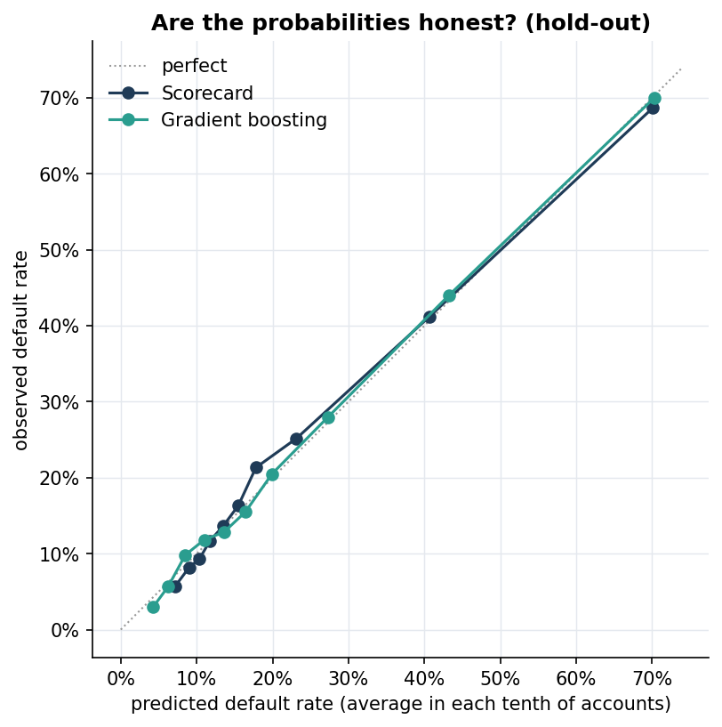
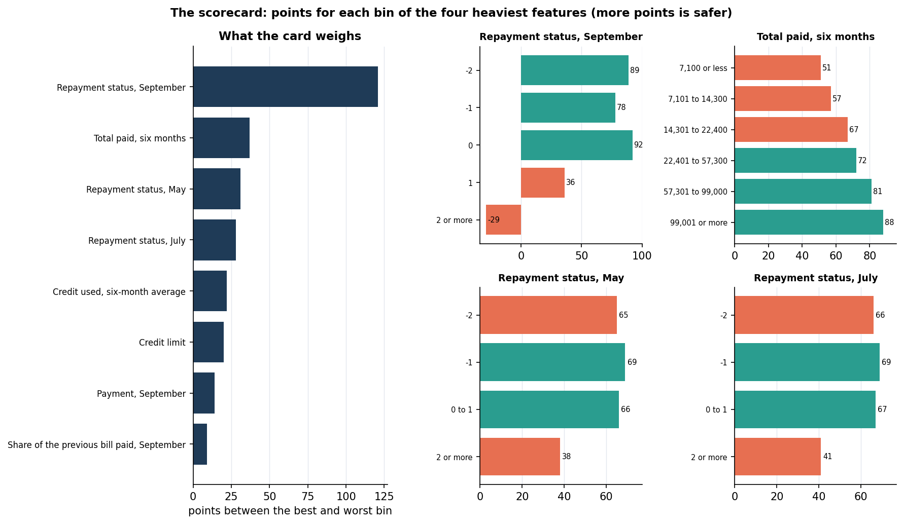
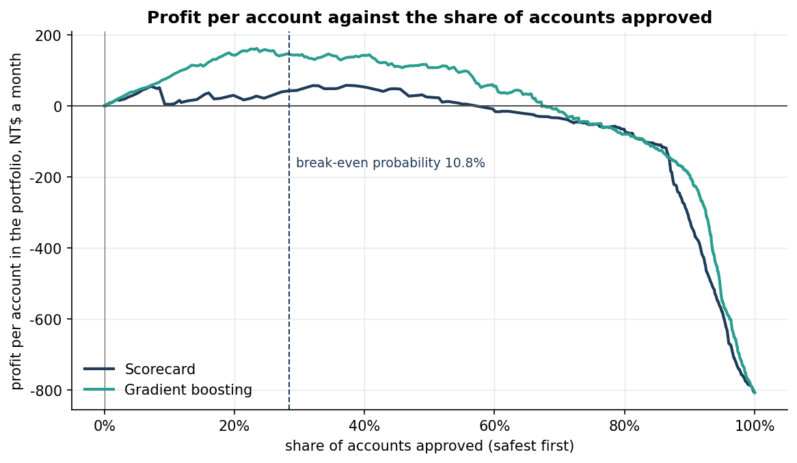

# Credit card default scorecard

**Who will miss next month's card payment, and where should a lender draw the line?**

A points scorecard of the kind banks use, built on 30,000 credit card accounts, tested against a gradient-boosting model, checked for calibration and fairness, and priced with Pakistan's policy rate: the dearer money gets, the safer an account has to be to be worth approving.

[**Interactive dashboard**](dashboard/dashboard.html) (open it in a browser; no server needed) · [Recommendation memo](docs/recommendation_memo.md) · [Method](docs/methodology.md) · [Model card](docs/model_card.md) · [Data sources](docs/data_sources.md) · [Walkthrough notebook](notebooks/credit_risk_walkthrough.ipynb)

> **Read this first.** The cardholders are 30,000 accounts of one bank in Taiwan in 2005, not Pakistani borrowers (I found no public borrower-level credit data for Pakistan). "Default" means *missing next month's payment*, not a loan written off. What is Pakistani is the cost of money (the State Bank of Pakistan's policy rate, 12% on 27 October 2026) and the card pricing (MCB's published markup). The yield, running cost and loss on a default are assumptions, and the answer moves a lot with them. This is a method demonstration, not lending advice.

## The answer

- **The risk is in recent behaviour.** 22.1% of the accounts missed the next payment. Accounts that paid the minimum last month defaulted 12.8% of the time, accounts one month late 34%, two months late 69%. The 23% of accounts that were late last month produced 52% of the defaults, so 48% of the defaults came from accounts that looked fine on that measure.
- **A transparent scorecard gets most of the way to a machine-learning model.** On 6,000 hold-out accounts the scorecard has an AUC of **0.768** (95% range 0.752 to 0.783): a random defaulter scores riskier than a random payer 76.8% of the time. A rule that only reads last month's status gets 0.706; gradient boosting gets 0.792. Gradient boosting ranks better by 0.023 AUC (95% range 0.017 to 0.031), a difference that is larger than the noise of a 6,000-account test. The scorecard keeps 92% of the gradient-boosting model's lead over a coin toss, and unlike it can be read line by line.
- **It finds defaults the naive rule cannot.** Among the 4,650 hold-out accounts that were *not* late last month (660 of them defaulted), the AUC is 0.53 for the naive rule, 0.66 for the scorecard and 0.71 for gradient boosting (0.5 is a coin toss).
- **Its probabilities are honest.** Calibration slope 1.00 on the hold-out (1.00 is perfect). The riskiest three tenths of accounts hold 61% of all defaults, against 57% for the naive rule and 64% for gradient boosting; in the riskiest tenth alone all three find about a third (31%, 32%, 32%): the obvious cases.
- **Fairness.** Sex, age, education and marital status are not inputs. At the break-even cut-off, 4 of 11 groups are approved at under four-fifths of the best-treated group's rate: age: 21-29, age: 50 and over, education: High school and education: University; for age: 21-29, age: 50 and over, education: High school and education: University the whole 95% bootstrap range of the ratio is under 0.80, for the rest it reaches above it. Adding sex, age, education and marital status changes the scorecard's hold-out AUC by +0.0004 (95% range -0.0012 to +0.0020) and the gradient-boosting model's by +0.0010 (-0.0009 to +0.0028), so leaving them out costs almost nothing.
- **The cut-off depends on the cost of money.** Under the stated assumptions (card APR 44%, money at the policy rate of 12%, loss 15% of the balance on a default) an account is worth approving only while its probability of default is under **10.8%**, which is a score of **549** or more. On the hold-out accounts that approves 28% of them, 7.6% of whom default, and earns NT$42 per account a month (95% range -NT$57 to NT$138) against -NT$807 if everyone were approved. The scorecard's profit is positive on average, but its 95% range reaches below zero, so it is not distinguishable from break-even on 6,000 accounts, and the gain over approving everyone is larger than the noise.
- **When the policy rate moves, so should the cut-off.** At the 7.25% low of 1 October 2021 the break-even probability is 12.9% and 42% of accounts are worth approving; at the 22% peak of 27 June 2023 it is 6.2% and 1%. At the peak, keeping the earlier cut-off would have lost money on the accounts it approved (-NT$194 per account a month, against NT$4 with the cut-off reset).

## Figures

| | |
|---|---|
|  |  |
|  |  |
|  |  |

More in [`docs/figures`](docs/figures): risk drivers, ROC and lift curves, score distribution, what the gradient-boosting model relies on, the sensitivity grid, the fairness audit and the Pakistan context.

## What was done

1. **Data.** The UCI "Default of Credit Card Clients" file (30,000 accounts, six months of status, bills and payments, and whether the account missed its payment in October 2005), cleaned without dropping any account ([details](docs/data_sources.md)).
2. **Split.** 24,000 accounts for building everything, 6,000 kept aside and used once. Identical accounts never straddle the split.
3. **Features.** 20 measures built from each account's own history (months late, share of the last bill paid, credit used, and so on).
4. **Scorecard.** Each candidate feature is binned by merging neighbours that lose least information, weights of evidence are fed to a logistic regression with positive, significant coefficients, and the result becomes whole points: 600 points at 20:1 odds of a good account, 40 points to double the odds. 8 of 21 candidates ended up in the card, in 37 bins.
5. **Challenger.** LightGBM, 14 settings tried by cross-validation, recalibrated; plus a naive rule for scale.
6. **Validation.** AUC, KS, Brier score, calibration, lift and population stability, with bootstrap ranges; cross-validation with every step refitted.
7. **Fairness audit.** Approval, error rates and calibration by sex, age, education and marital status, and whether the inputs act as a stand-in for them.
8. **Cut-off.** Profit per unit of balance, month by month, under stated assumptions, then repeated for the policy rate on six dates and for a grid of assumptions.

## Results

| Model | AUC, cross-validated | AUC, hold-out (95% range) | KS, hold-out (95% range) | Brier | Calibration slope | Defaults in riskiest tenth |
| --- | ---: | ---: | ---: | ---: | ---: | ---: |
| Naive: last month's status only | 0.713 | **0.706** (0.688 to 0.723) | 0.356 (0.327 to 0.385) | 0.1427 | 0.98 | 32% |
| Scorecard | 0.769 | **0.768** (0.752 to 0.783) | 0.402 (0.379 to 0.432) | 0.1373 | 1.00 | 31% |
| Scorecard + sex, age, education, marriage | 0.769 | **0.768** (0.753 to 0.783) | 0.402 (0.379 to 0.432) | 0.1373 | 1.00 | 31% |
| Gradient boosting | 0.786 | **0.792** (0.777 to 0.806) | 0.443 (0.420 to 0.473) | 0.1332 | 1.01 | 32% |
| Gradient boosting + sex, age, education, marriage | 0.787 | **0.793** (0.778 to 0.807) | 0.444 (0.422 to 0.474) | 0.1328 | 1.02 | 32% |

AUC is the chance that a random defaulter scores riskier than a random payer (0.5 is a coin toss, 1 is perfect); KS is the largest gap between the two groups' cumulative score distributions. Cross-validated AUC is the average of 3 × 5 refits on the development accounts; the hold-out columns are the single final test. Which differences are bigger than chance:

| Comparison | AUC difference | 95% range | Verdict |
| --- | ---: | ---: | --- |
| Scorecard against naive: last month's status only | +0.0624 | +0.0490 to +0.0758 | a real difference |
| Gradient boosting against Scorecard | +0.0234 | +0.0170 to +0.0306 | a real difference |
| Scorecard + sex, age, education, marriage against Scorecard | +0.0004 | -0.0012 to +0.0020 | within the noise |
| Gradient boosting + sex, age, education, marriage against Gradient boosting | +0.0010 | -0.0009 to +0.0028 | within the noise |

### The scorecard

The card's three heaviest features are Repayment status, September (121 points between its best and worst bin), Total paid, six months (37) and Repayment status, May (31). The score is the sum of the points; more points is safer. The full card is in the [method](docs/methodology.md); the first three features:

| Feature | Bin | Accounts | Default rate | Points |
| --- | --- | ---: | ---: | ---: |
| **Repayment status, September** | -2 | 2,205 | 13.3% | 89 |
|  | -1 | 4,539 | 16.6% | 78 |
|  | 0 | 11,788 | 12.7% | 92 |
|  | 1 | 2,946 | 34.3% | 36 |
|  | 2 or more | 2,522 | 69.5% | -29 |
| **Total paid, six months** | 7,100 or less | 6,426 | 30.8% | 51 |
|  | 7,101 to 14,300 | 5,578 | 26.1% | 57 |
|  | 14,301 to 22,400 | 3,209 | 19.1% | 67 |
|  | 22,401 to 57,300 | 5,588 | 16.5% | 72 |
|  | 57,301 to 99,000 | 1,597 | 12.0% | 81 |
|  | 99,001 or more | 1,602 | 9.2% | 88 |
| **Repayment status, May** | -2 | 3,641 | 19.8% | 65 |
|  | -1 | 4,418 | 15.8% | 69 |
|  | 0 to 1 | 13,561 | 19.0% | 66 |
|  | 2 or more | 2,380 | 55.0% | 38 |

The gradient-boosting model leans on Repayment status, September, Months since the last late payment and Worst repayment status in six months.

### What approving is worth

Profit per account in the whole portfolio, per month, on the hold-out accounts and the base-case assumptions (declined accounts earn nothing):

| Rule | Approved | Default rate of approved | Profit per account a month | 95% range | Better than approving everyone by |
| --- | ---: | ---: | ---: | ---: | ---: |
| Approve everyone | 100% | 22.1% | -NT$807 | -NT$972 to -NT$658 |  |
| Approve if not late last month (status 0 or better) | 78% | 14.2% | -NT$70 | -NT$193 to NT$43 | NT$738 (NT$643 to NT$842) |
| Scorecard, at the break-even probability | 28% | 7.6% | NT$42 | -NT$57 to NT$138 | NT$850 (NT$730 to NT$986) |
| Gradient boosting, at the break-even probability | 34% | 6.8% | NT$146 | NT$81 to NT$209 | NT$953 (NT$815 to NT$1,103) |

### The policy rate and the cut-off

| Policy rate on | Rate | Margin a month | Break-even probability | Approved | Default rate of approved | Profit per account a month | If the Oct 2021 cut-off were kept |
| --- | ---: | ---: | ---: | ---: | ---: | ---: | ---: |
| 1 October 2021 | 7.25% | 2.21% | 12.9% | 42% | 9.1% | NT$156 | NT$156 |
| 8 July 2022 | 15% | 1.57% | 9.5% | 18% | 6.5% | -NT$11 | -NT$28 |
| 27 June 2023 | 22% | 0.99% | 6.2% | 1% | 5.1% | NT$4 | -NT$194 |
| 17 December 2024 | 13% | 1.74% | 10.4% | 25% | 7.5% | NT$7 | NT$20 |
| 16 December 2025 | 10.5% | 1.94% | 11.5% | 33% | 7.8% | NT$85 | NT$79 |
| 27 October 2026 | 12% | 1.82% | 10.8% | 28% | 7.6% | NT$42 | NT$43 |

### How much the assumptions matter

Share of accounts worth approving (and the break-even probability) for combinations of card APR and loss on a default, at the current policy rate; across this grid the break-even probability runs from 1.9% to 15.4% and the share approved from 0% to 55%:

| Card APR, loss on a default: | 10% | 15% | 20% | 30% | 40% |
| --- | ---: | ---: | ---: | ---: | ---: |
| 44% | 55% (under 15.4%) | 28% (under 10.8%) | 11% (under 8.3%) | 0% (under 5.7%) | 0% (under 4.3%) |
| 36% | 28% (under 11.0%) | 6% (under 7.6%) | 0% (under 5.8%) | 0% (under 3.9%) | 0% (under 3.0%) |
| 30% | 6% (under 7.3%) | 0% (under 5.0%) | 0% (under 3.8%) | 0% (under 2.6%) | 0% (under 1.9%) |

### Fairness at the cut-off

| Group (hold-out) | Accounts | Default rate | Predicted | Predicted ÷ observed | Approved | Default rate of approved | Disparate impact | 95% range of the ratio |
| --- | ---: | ---: | ---: | ---: | ---: | ---: | ---: | ---: |
| Sex: Female | 3,645 | 20.9% | 20.8% | 1.00 | 30% | 8.2% | 1.00 | 1.00 to 1.00 |
| Sex: Male | 2,355 | 24.1% | 23.6% | 0.98 | 26% | 6.4% | 0.85 | 0.78 to 0.92 |
| Age: 21-29 | 1,936 | 23.1% | 23.6% | 1.02 | 23% | 5.7% | 0.66 **flag** | 0.59 to 0.73 |
| Age: 30-39 | 2,222 | 20.1% | 20.2% | 1.01 | 34% | 7.6% | 1.00 | 1.00 to 1.00 |
| Age: 40-49 | 1,283 | 22.7% | 21.5% | 0.95 | 29% | 8.5% | 0.86 | 0.77 to 0.95 |
| Age: 50 and over | 559 | 25.4% | 23.5% | 0.93 | 23% | 10.9% | 0.67 **flag** | 0.57 to 0.79 |
| Education: Graduate school | 2,082 | 18.9% | 19.1% | 1.01 | 37% | 6.7% | 1.00 | 1.00 to 1.00 |
| Education: High school | 991 | 25.6% | 25.9% | 1.01 | 18% | 7.9% | 0.48 **flag** | 0.41 to 0.55 |
| Education: Other or unknown | 93 | 5.4% | 16.4% | 3.05 | 42% | 7.7% |  |  |
| Education: University | 2,834 | 23.8% | 22.7% | 0.96 | 25% | 8.4% | 0.68 **flag** | 0.62 to 0.74 |
| Marital status: Married | 2,718 | 23.4% | 21.9% | 0.93 | 29% | 9.3% | 1.00 | 0.94 to 1.00 |
| Marital status: Other or unknown | 69 | 23.2% | 24.4% | 1.05 | 10% | 14.3% |  |  |
| Marital status: Single | 3,213 | 21.0% | 21.9% | 1.04 | 28% | 6.0% | 0.98 | 0.91 to 1.00 |

"Disparate impact" is a group's approval rate over that of the best-treated group; under 0.80 is flagged (the "four-fifths" screening rule used in US lending and employment practice, not a Pakistani legal test). "Predicted ÷ observed" near 1.00 means the model is neither too harsh nor too lenient on that group on average. Details and the proxy test are in the [model card](docs/model_card.md).

## What this cannot tell you

- **Not Pakistani data.** The accounts are Taiwanese, from a crisis-era card book where 22.1% missed a payment in one month. A Pakistani lender would refit the scorecard on its own accounts; what carries over is the method and the link between the policy rate and the cut-off.
- **Default is a missed payment.** It is not a charge-off, so the loss on a default is an assumption, and the cut-off moves a lot with it.
- **The economics are assumptions.** Only the card APR (44%, MCB's published "up to") and the policy rate are sourced. The share of balances that revolve (88%) is measured in this file; running cost (5%) and loss (15%) are not.
- **One cohort.** The file is a single snapshot, so there is no later period to test the scorecard against and no way to see how it holds up through a cycle.
- **Selection.** These are accounts the bank had already approved. Applicants it turned down are not here.
- **Repayment codes.** The documentation does not explain a status of -2 or 0, and a status of 1 ("one month late") appears 3,688 times in September but only 6 times in the four months before August, so the earlier months look to be coded on another basis. The scorecard treats any status of 1 or more as late.
- **One month of margin.** An approved account that keeps paying earns again next month; counting one month understates what good accounts are worth.

## Run it

```
pip install -r requirements.txt
python -m creditrisk verify      # every raw file matches its checksum
python -m creditrisk build       # clean the data and make the features
python -m creditrisk analyze     # fit, validate, audit, price (about 10 minutes)
python -m creditrisk report      # figures, dashboard and documents
python -m creditrisk all         # build, analyze and report in one go
```

The raw data are in the repository (they are CC BY 4.0), so nothing is downloaded unless you ask for it with `python -m creditrisk ingest --refresh`. The notebook is rebuilt with `pip install -r requirements-notebook.txt` and `python -m creditrisk notebook`. Tests and the linter: `pip install -r requirements-dev.txt`, then `pytest -q` and `ruff check .`. A fixed seed makes a rerun on the same versions of the libraries give the same numbers.

## Repository map

| Path | What is in it |
|---|---|
| `creditrisk/` | the package: `ingest`, `build`, `binning`, `scorecard`, `models`, `validation`, `fairness`, `economics`, `macro`, `analysis`, `charts`, `dashboard`, `docs`, `notebook` |
| `data/raw/` | the UCI file and the World Bank series, with `MANIFEST.json` (source, date, size, SHA-256 of each) |
| `data/reference/` | the SBP policy rate, typed in from announcements with a source for every change |
| `data/processed/` | every table behind the figures and documents, and `summary.json` |
| `docs/` | the memo, method, model card, data sources and the figures |
| `dashboard/` | the interactive dashboard: one HTML file with the data inside |
| `notebooks/` | a walkthrough that refits the scorecard and checks it against the committed results |
| `tests/` | automated tests on made-up portfolios with known answers, and on the committed results |

## Data, licences and credit

Cardholder data: Yeh, I-C. and Lien, C-H. (2009). The comparisons of data mining techniques for the predictive accuracy of probability of default of credit card clients. Expert Systems with Applications 36(2), 2473-2480. doi:10.1016/j.eswa.2007.12.020 UCI Machine Learning Repository, [dataset 350](https://archive.ics.uci.edu/dataset/350/default+of+credit+card+clients), CC BY 4.0. Pakistan bank and credit series: World Bank, CC BY 4.0. Card APR: [MCB credit card summary box](https://www.mcb.com.pk/assets/documents/Credit-card-Summary-Box-1-July-to-Dec-16-Sep-2026-Font-11-English.pdf), July to December 2026. Policy rates: State Bank of Pakistan announcements as reported (a source for each change is in [`data/reference/policy_rate.csv`](data/reference/policy_rate.csv)). The code and documents are released under the [MIT licence](LICENSE); the data belong to their sources, see [`docs/data_sources.md`](docs/data_sources.md).
